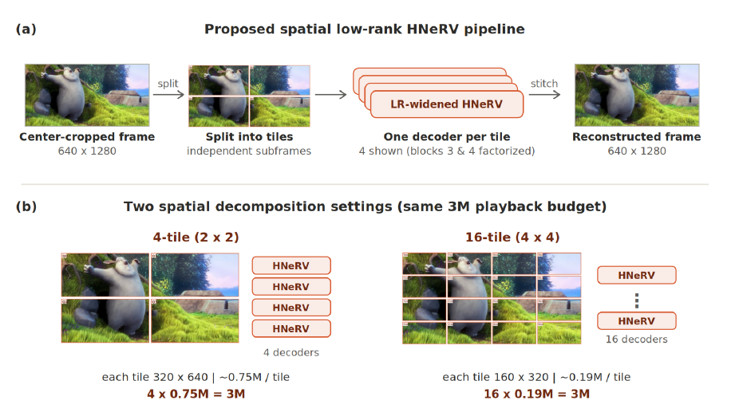

# Less is More: Low-Rank Widened HNeRV with Spatial Decomposition

**Code for the revised manuscript, “Less is More: Low-Rank Widened HNeRV with Spatial Decomposition for Efficient Neural Video Representation.”**

Tamer Shanableh · Madeeha Balouch · Muhammad Hannan Akhtar · Ihab Amer



*A video frame is split into independent spatial tiles, represented by low-rank widened HNeRV decoders, and stitched back into a full frame. The 2 × 2 and 4 × 4 layouts compare spatial granularity at approximately the same 3M playback-parameter budget.*

## Overview

Neural video representations store a video in learned frame embeddings and a compact decoder. **Less is More** reduces decoder arithmetic while preserving the parameter budget: it factorizes the expensive decoder stages, reinvests saved parameters in wider features, and optionally gives each spatial tile its own decoder.

- **Low-rank widening:** factorize decoder blocks 3 and 4, then widen the decoder within the target budget.
- **Spatial decomposition:** train independent models on 2 × 2 or 4 × 4 tiles and stitch their outputs for full-frame evaluation.
- **Playback-aware evaluation:** pack decoder weights and frame embeddings, reload the archive, and measure rate and reconstruction quality on decoded frames.

This repository contains the whole-frame implementation, the spatial training pipeline adapted from [HNeRV](https://github.com/haochen-rye/HNeRV), experiment configurations, and packed-archive evaluation tools.

## Results

The revised manuscript reports these five-sequence means for 132 frames at 640 × 1280 and an approximately 3M-parameter budget. PSNR and BPP come from decoded packed representations:

| Model | Parameters | Decoder GFLOPs | Packed BPP | PSNR ↑ |
| --- | ---: | ---: | ---: | ---: |
| Dense, whole frame | 3.013M | 114.48 | 0.236556 | 34.854 dB |
| Low-rank widened, whole frame | 3.038M | 78.01 | 0.238319 | 34.930 dB |
| Dense, 4 tiles | 2.894M | 27.80 | 0.218284 | 34.473 dB |
| Low-rank widened, 4 tiles | 2.975M | 19.20 | 0.224521 | 34.464 dB |
| Low-rank widened, 16 tiles | 3.040M | 7.39 | 0.234649 | 31.616 dB |

In the paper's NVIDIA A10G playback measurements, the four-tile model runs at 5.214 ms/frame (191.79 FPS), compared with 10.275 ms/frame (97.32 FPS) for dense whole-frame HNeRV. These are **manuscript values**, not results regenerated from checkpoints in this repository. The separate native-resolution UVG experiment reports 32.70 dB and 28.80 **GMACs** for four tiles at 1080 × 1920; its arithmetic unit and protocol differ from the table above. See [paper reproduction notes](docs/PAPER_REPRODUCTION.md) for protocol details and artifact provenance.

## Getting started

Run commands from the repository root. Whole-frame and spatial training use different PyTorch dependency stacks, so create a separate environment for each. Create the spatial environment with a Python 3.8 interpreter:

```bash
# Whole-frame models
python -m venv .venv-whole
# Activate the environment with your shell's usual command.
python -m pip install -r requirements-lowrank.txt

# In a separate environment for the spatial HNeRV implementation
python -m venv .venv-spatial
# Activate .venv-spatial before the next command.
python -m pip install -r requirements-spatial-reference.txt
```

The whole-frame requirements target CUDA 12.8. The spatial requirements preserve the original HNeRV-era PyTorch pins; use a compatible CUDA environment for that stack. For a CPU-only check of the archive format and configurations, use another clean environment:

```bash
python -m venv .venv-test
# Activate .venv-test before the next command.
python -m pip install -r requirements-test.txt
python -m pytest -q tests/test_release_cpu.py
```

### Prepare frames

Download [Big Buck Bunny](https://studio.blender.org/projects/big-buck-bunny/) and sequences from the [UVG dataset](https://github.com/ultravideo/UVG-4K-Dataset), then decode each video into naturally numbered RGB images. The main five-sequence protocol uses Bunny, HoneyBee, Jockey, ReadySetGo, and YachtRide: 132 frames per sequence, center-cropped to 640 × 1280.

```text
raw_frames/bunny/000000.png
raw_frames/bunny/000001.png
...
```

```bash
python scripts/prepare_frames.py --source raw_frames/bunny --output data/bunny --start-index 0 --count 132 --height 640 --width 1280 --mode crop
```

Set `--start-index` to the first frame of the sequence you intend to use. The preparation script records selected files and hashes. The exact source-frame offsets used for the manuscript are not bundled.

### Train

The unified runner covers the principal whole-frame and four-tile settings. These examples train one sequence for 300 epochs on GPU 0:

```bash
# Dense whole-frame reference
python run_framework.py wholeframe --data_root data --runs_root runs/dense --only bunny --dense_only --epochs 300 --gpu 0

# Low-rank widened whole frame (rank 88, blocks 3 and 4)
python run_framework.py wholeframe --data_root data --runs_root runs/lrwide --only bunny --skip_baseline --lowrank_specs widened:3,4 --epochs 300 --gpu 0

# Low-rank widened 2 × 2 tiles (rank 43 per tile)
python run_framework.py spatial4 --data_root data --spatial_runs_root runs/spatial --sequence bunny --tag bunny_4tile --epochs 300 --gpu 0
```

The dense four-tile comparison uses `spatial/configs/quadrant_dense_3m_reference.json` with `spatial-custom`. For the manuscript's rank-23 sixteen-tile configuration, use:

```bash
python run_framework.py spatial-custom --config spatial/configs/tile16_rank23_0p198_unverified.json --data_root data --spatial_runs_root runs/spatial --sequence bunny --tag bunny_16tile_rank23 --epochs 300 --gpu 0
```

The historical `spatial16` preset uses rank 22. The rank-23 configuration follows the manuscript description, but its original checkpoint tensors are unavailable here for verification; consult the [configuration map](docs/PAPER_REPRODUCTION.md) when comparing to paper numbers.

### Decode and evaluate

Evaluate a whole-frame checkpoint by packing its decoder and embeddings into a ZIP archive, loading that archive, and measuring full-frame reconstruction:

```bash
python -m src.evaluate_packed --checkpoint runs/lrwide/bunny/lowrank_wide_b34/lowrank_wide_b34_last.pt --model-type lrwide --frames data/bunny --archive runs/eval/bunny_lrwide.zip --report runs/eval/bunny_lrwide.json --recon-dir runs/eval/bunny_lrwide_frames --device cuda
```

This command defaults to 132 frames at 640 × 1280, with 8-bit decoder weights, 8-bit embeddings, and 10% pruning. Use `--model-type dense` for a dense checkpoint. For a spatial run, supply every tile checkpoint from the same experiment:

```bash
python spatial/evaluate_packed.py --config spatial/configs/quadrant_equal_lrwide.json --frames data/bunny --archive runs/eval/bunny_4tile.zip --report runs/eval/bunny_4tile.json --device cuda --tile Q0=PATH/TO/Q0/quant_vid.pth --tile Q1=PATH/TO/Q1/quant_vid.pth --tile Q2=PATH/TO/Q2/quant_vid.pth --tile Q3=PATH/TO/Q3/quant_vid.pth
```

Spatial settings use the quantization values in their JSON configuration. To play back an existing spatial archive, run the same evaluator with `--frames`, `--archive`, and optionally `--recon-dir`, omitting `--config` and `--tile`. Packed BPP includes all archive bytes; PSNR and SSIM are computed on reconstructed full RGB frames.

## Repository layout

| Path | Contents |
| --- | --- |
| [`src/`](src/) | Whole-frame models, training, metrics, and packed evaluation |
| [`spatial/`](spatial/) | Tile preparation, HNeRV training, stitching, and packed evaluation |
| [`spatial/configs/`](spatial/configs/) | Four-tile and sixteen-tile experiment configurations |
| [`scripts/`](scripts/) | Frame preparation and checkpoint inspection |
| [`docs/PAPER_REPRODUCTION.md`](docs/PAPER_REPRODUCTION.md) | Experiment mapping, metric conventions, and reproduction notes |

## Checkpoints, citation, and attribution

Training frames and pretrained checkpoints are not distributed with this repository. To reproduce the manuscript's exact numbers, the original frame selections and evaluated checkpoints are also required.

The revised paper is submitted for publication; a DOI and final citation are not yet available. Until then, cite:

```bibtex
@misc{shanableh_less_is_more,
  title  = {Less is More: Low-Rank Widened HNeRV with Spatial Decomposition for Efficient Neural Video Representation},
  author = {Shanableh, Tamer and Balouch, Madeeha and Akhtar, Muhammad Hannan and Amer, Ihab},
  note   = {Revised manuscript submitted for publication}
}
```

The spatial implementation adapts the [official HNeRV code](https://github.com/haochen-rye/HNeRV). Please acknowledge that work when using the spatial pipeline. Repository licensing is pending an author and upstream review.
